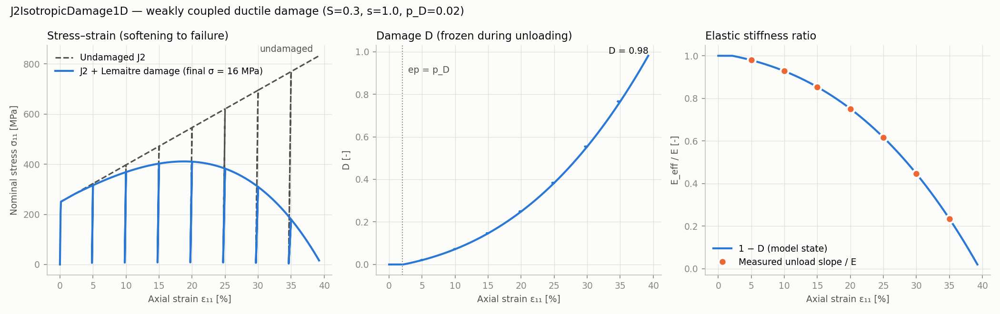
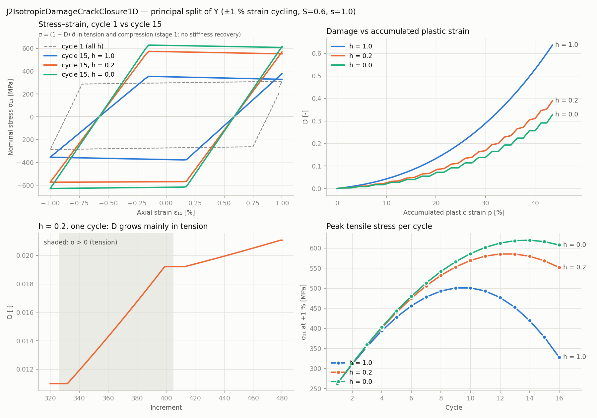
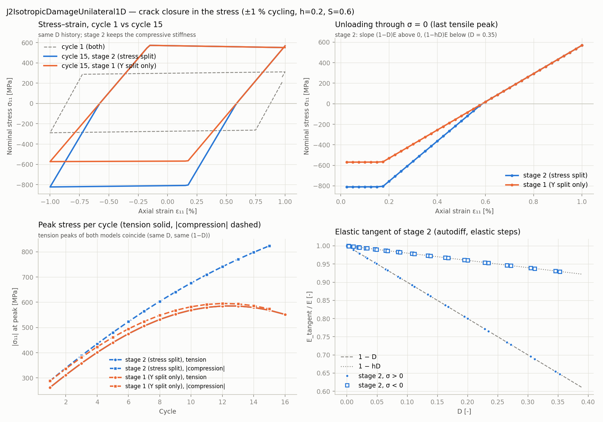

```{include} ../../../src/returnmap/models/j2_damage/README.md
```

## 挙動の図

3 つの段階の挙動を、`1D` のモデルで示す。図は `docs/figures/` のスクリプトが描く (`make docs-figures`)。

### 損傷の進展と剛性の低下

`J2IsotropicDamage1D` の単調引張に、除荷と再載荷を挟んだ履歴 (`S = 0.3`、`s = 1.0`、`p_D = 0.02`)。スクリプトは `docs/figures/j2_damage.py` である。



| 図 | 内容 |
|---|---|
| 左 | 公称応力とひずみ。破線は損傷の無い J2 である。損傷の進展により、応力は最大値を経て低下する |
| 中央 | 損傷 `D`。累積塑性ひずみがしきい値 `p_D` を超えた後に増加する。除荷と再載荷の間は変化しない |
| 右 | 弾性剛性の比。応力-ひずみ曲線から測った除荷の傾き (点) は、`(1 − D) E` (線) と一致する |

### 引張と圧縮での損傷の進み方

`J2IsotropicDamageCrackClosure1D` の ±1 % のひずみ繰返し (`S = 0.6`、`s = 1.0`)。係数 `h` は、圧縮が損傷を進める割合である。スクリプトは `docs/figures/j2_damage_crack_closure.py` である。



| 図 | 内容 |
|---|---|
| 左上 | 1 サイクル目と 15 サイクル目の応力-ひずみ。`h = 1` (分けない) は損傷が最も速く進み、応力の低下が大きい |
| 右上 | 損傷と累積塑性ひずみ。`h < 1` では、引張の半サイクルで大きく、圧縮の半サイクルで小さく進むため、階段状になる |
| 左下 | `h = 0.2` の 1 サイクル。網掛けは引張 (σ > 0) の区間である |
| 右下 | サイクルごとの引張側の最大応力 |

この段階で分けるのは、損傷を進める力 `Y` のみである。公称応力は、引張でも圧縮でも `σ = (1 − D) σ̃` であり、圧縮で剛性は回復しない。

### 圧縮での剛性の回復

`J2IsotropicDamageUnilateral1D` (図では stage 2) と `J2IsotropicDamageCrackClosure1D` (stage 1) の比較。±1 % のひずみ繰返し、`h = 0.2`、`S = 0.6`。スクリプトは `docs/figures/j2_damage_unilateral.py` である。



| 図 | 内容 |
|---|---|
| 左上 | 1 サイクル目と 15 サイクル目の応力-ひずみ。1D では 2 つのモデルの `D` の履歴は同じであり、異なるのは圧縮側の応力のみである |
| 右上 | 引張の最大点からの除荷。準片側のモデルは、σ = 0 を通る点で傾きが `(1 − D) E` から `(1 − hD) E` に変わる |
| 左下 | サイクルごとの最大応力。引張側は 2 つのモデルで一致する |
| 右下 | 準片側のモデルの弾性接線 (自動微分)。引張では `1 − D`、圧縮では `1 − hD` に一致する |
